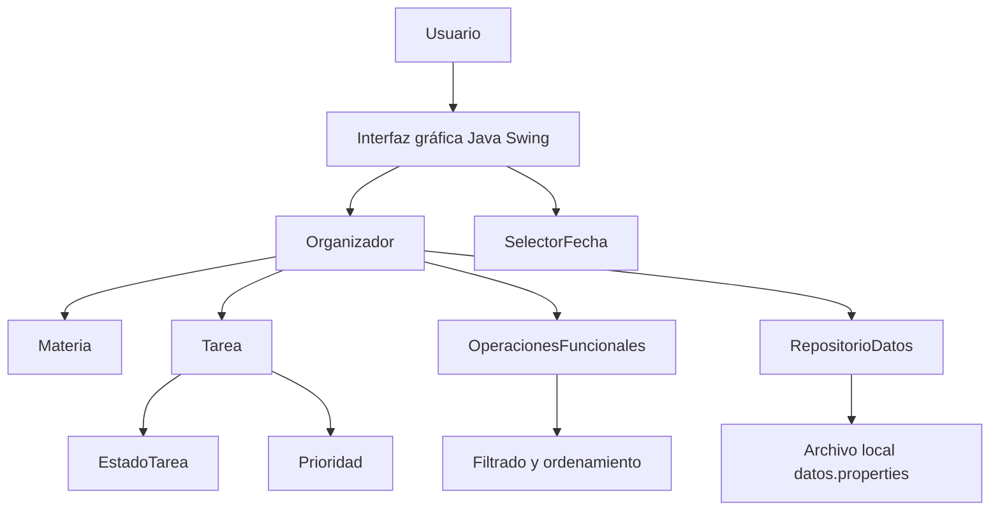

# Organizador de Tareas Académicas

**Universidad Fidélitas — SC-250 Paradigmas de Programación**

## Integrantes del grupo

- Melissa Solís Benavides
- Roberto Acuña Ballestero

## Repositorio

https://github.com/robertoAcunaBallestero/ProyectoOrganizadorDeTareasAcad-micas.git

---

# 1. Descripción del proyecto

El presente proyecto corresponde al desarrollo de un **Organizador de Tareas Académicas**, creado como una aplicación práctica para demostrar la integración de dos paradigmas de programación dentro de una misma solución:

- **Programación Orientada a Objetos**
- **Programación funcional**

La aplicación permite administrar materias y tareas académicas, registrar fechas de entrega, establecer prioridades, cambiar el estado de las tareas y consultar la información por medio de distintos filtros y opciones de ordenamiento.

El sistema fue desarrollado en **Java** y utiliza **Java Swing** para la interfaz gráfica.

El propósito principal del proyecto no consiste únicamente en crear una herramienta para organizar tareas, sino en demostrar cómo distintos paradigmas de programación pueden utilizarse de forma complementaria para resolver diferentes partes de un mismo problema.

---

# 2. Objetivo del proyecto

Desarrollar un **Organizador de Tareas Académicas** que permita aplicar de manera integrada los paradigmas de **Programación Orientada a Objetos** y **programación funcional**, utilizando cada enfoque en las partes de la solución donde resulte más adecuado.

---

# 3. Objetivos específicos

- Diseñar la estructura del sistema mediante Programación Orientada a Objetos.
- Representar materias y tareas mediante clases y objetos.
- Implementar funcionalidades para registrar, consultar y actualizar tareas académicas.
- Aplicar programación funcional para filtrar y ordenar colecciones de tareas.
- Mantener separada la lógica de gestión de objetos de la lógica de procesamiento funcional.
- Desarrollar una interfaz gráfica sencilla y funcional.
- Guardar y recuperar la información de forma local.
- Aplicar Scrum como marco de trabajo para organizar el desarrollo.

---

# 4. Paradigmas de programación aplicados

## 4.1 Programación Orientada a Objetos

La Programación Orientada a Objetos se utiliza para representar las principales entidades del sistema y administrar su comportamiento.

Las clases principales son:

- `Materia`
- `Tarea`
- `Organizador`

Cada una de estas clases posee atributos y métodos relacionados con su función dentro del sistema.

Por ejemplo:

- Una `Materia` contiene un identificador, un nombre y una lista de tareas asociadas.
- Una `Tarea` contiene título, descripción, fecha de entrega, prioridad, estado y materia.
- `Organizador` administra el registro, consulta, modificación y eliminación de materias y tareas.

También se utilizan enumeraciones para controlar valores específicos:

- `Prioridad`
- `EstadoTarea`

Esto permite mantener valores válidos dentro del sistema y evitar inconsistencias.

---

## 4.2 Programación funcional

La programación funcional se aplica principalmente en el procesamiento de colecciones de tareas.

La clase `OperacionesFuncionales` utiliza características modernas de Java como:

- `Stream`
- `filter()`
- `sorted()`
- `Comparator`
- expresiones lambda
- referencias a métodos
- `toList()`

Estas operaciones permiten:

- Filtrar tareas por materia.
- Filtrar tareas por estado.
- Filtrar tareas por prioridad.
- Ordenar tareas por fecha.
- Ordenar tareas por prioridad.
- Combinar filtros.
- Obtener nuevas listas sin modificar la colección original.

Esta separación permite demostrar de manera clara cómo la Programación Orientada a Objetos administra las entidades del sistema y cómo la programación funcional procesa los datos.

---

# 5. Arquitectura general



La interfaz recibe las acciones del usuario y utiliza la clase `Organizador` para coordinar la lógica principal.

Las operaciones de filtrado y ordenamiento se delegan a `OperacionesFuncionales`.

El almacenamiento local se administra mediante `RepositorioDatos`.

La selección de fechas se realiza mediante `SelectorFecha`.

---

# 6. Estructura del proyecto

```text
ProyectoOrganizadorDeTareasAcad-micas/
│
├── src/
│   └── main/
│       └── java/
│           └── com/
│               └── mycompany/
│                   └── proyectoorganizadortareas/
│                       ├── EstadoTarea.java
│                       ├── Materia.java
│                       ├── OperacionesFuncionales.java
│                       ├── Organizador.java
│                       ├── Prioridad.java
│                       ├── ProyectoOrganizadorTareas.java
│                       ├── RepositorioDatos.java
│                       ├── SelectorFecha.java
│                       └── Tarea.java
│
├── pom.xml
├── .gitignore
└── README.md
```

---

# 7. Descripción de las clases

## 7.1 `Materia`

Representa una materia académica.

Contiene:

- ID.
- Nombre.
- Lista de tareas asociadas.

Permite:

- Consultar su información.
- Modificar el nombre.
- Agregar tareas.
- Eliminar tareas.
- Obtener una copia de su lista de tareas.

---

## 7.2 `Tarea`

Representa una tarea académica.

Contiene:

- ID.
- Título.
- Descripción.
- Fecha de entrega.
- Prioridad.
- Estado.
- Materia asociada.

Toda nueva tarea inicia con estado:

```text
PENDIENTE
```

La clase incluye validaciones para evitar información inválida.

---

## 7.3 `Organizador`

Es la clase principal encargada de coordinar la lógica del sistema.

Permite:

- Registrar materias.
- Consultar materias.
- Buscar materias.
- Registrar tareas.
- Consultar tareas.
- Buscar tareas.
- Modificar tareas.
- Eliminar tareas.
- Cambiar estados.
- Filtrar tareas.
- Ordenar tareas.
- Mantener los identificadores consecutivos.

También se encarga de mantener correctamente la relación entre las tareas y las materias.

---

## 7.4 `OperacionesFuncionales`

Se encarga de las operaciones funcionales realizadas sobre las colecciones de tareas.

Incluye:

- Filtrado por materia.
- Filtrado por estado.
- Filtrado por prioridad.
- Ordenamiento por fecha.
- Ordenamiento por prioridad.
- Combinación de filtros.

Estas operaciones utilizan Streams y devuelven nuevas listas.

---

## 7.5 `EstadoTarea`

Enumeración que define los estados válidos:

```text
PENDIENTE
COMPLETADA
```

---

## 7.6 `Prioridad`

Enumeración que define las prioridades disponibles:

```text
ALTA
MEDIA
BAJA
```

---

## 7.7 `RepositorioDatos`

Clase encargada de guardar y recuperar la información del sistema.

Utiliza un archivo local llamado:

```text
datos.properties
```

La información se guarda dentro de:

```text
~/.academia-organizador/
```

No se requiere base de datos ni conexión a Internet.

---

## 7.8 `SelectorFecha`

Implementa un calendario gráfico desarrollado con Java Swing.

Permite:

- Cambiar de mes.
- Seleccionar una fecha.
- Seleccionar el día actual.
- Cancelar la selección.

---

## 7.9 `ProyectoOrganizadorTareas`

Es la clase principal del sistema.

Contiene:

- Método `main`.
- Interfaz gráfica.
- Menú lateral.
- Tabla de tareas.
- Filtros.
- Buscador.
- Formularios.
- Avisos.
- Acciones de edición.
- Cambio de estado.
- Eliminación.
- Integración con el resto de las clases.

---

# 8. Funcionalidades implementadas

El sistema permite:

- Registrar materias.
- Consultar materias.
- Registrar tareas.
- Asociar tareas con materias.
- Agregar descripción.
- Asignar prioridad.
- Registrar fecha de entrega.
- Seleccionar fecha mediante calendario.
- Consultar tareas.
- Modificar tareas.
- Eliminar tareas.
- Cambiar estado.
- Marcar tareas como pendientes.
- Marcar tareas como completadas.
- Buscar tareas.
- Filtrar por materia.
- Filtrar por estado.
- Filtrar por prioridad.
- Ordenar por fecha.
- Ordenar por prioridad.
- Mostrar total de materias.
- Mostrar total de tareas.
- Mostrar tareas pendientes.
- Mostrar tareas completadas.
- Mostrar avisos.
- Detectar tareas vencidas.
- Detectar tareas que vencen hoy.
- Detectar tareas próximas a vencer.
- Guardar automáticamente la información.
- Recuperar datos al volver a ejecutar el sistema.

---

# 9. Interfaz gráfica

La interfaz fue desarrollada mediante **Java Swing**.

La pantalla principal incluye:

- Menú lateral.
- Resumen de materias.
- Total de tareas.
- Tareas pendientes.
- Tareas completadas.
- Avisos.
- Buscador.
- Filtro por materia.
- Filtro por estado.
- Filtro por prioridad.
- Ordenamiento.
- Tabla de tareas.
- Botón de edición.
- Botón de cambio de estado.
- Botón de eliminación.

---

# 10. Menú principal

El menú lateral incluye las opciones:

- Inicio / tareas.
- Mis materias.
- Agregar materia.
- Nueva tarea.
- ¿Cómo usar?

---

# 11. Avisos de entregas

El sistema analiza las fechas de las tareas pendientes.

Puede identificar:

- Tareas vencidas.
- Tareas que vencen hoy.
- Tareas que vencen en los próximos tres días.

También existe una opción para visualizar las entregas pendientes ordenadas por fecha.

---

# 12. Guardado automático

Cada vez que se realiza un cambio importante, el sistema intenta guardar la información.

El guardado se realiza localmente y no requiere servicios externos.

El sistema utiliza un archivo temporal antes de reemplazar el archivo principal, con el fin de reducir el riesgo de pérdida de información.

---

# 13. Persistencia de datos

La información se almacena mediante propiedades.

Los datos guardados incluyen:

- Materias.
- IDs.
- Títulos.
- Descripciones.
- Fechas.
- Prioridades.
- Estados.
- Relaciones entre tareas y materias.
- Consecutivos de IDs.

---

# 14. Requisitos de instalación

Se recomienda tener instalado:

- Git.
- JDK.
- Maven.
- NetBeans, IntelliJ IDEA, Visual Studio Code u otro IDE compatible con Java.

---

# 15. Versión de Java

El archivo `pom.xml` está configurado actualmente con:

```xml
<maven.compiler.release>25</maven.compiler.release>
```

Por lo tanto, para compilar con la configuración actual se requiere **JDK 25**.

---

# 16. Verificar herramientas

Desde una terminal:

```powershell
java --version
javac --version
mvn --version
git --version
```

---

# 17. Clonar el repositorio

```powershell
git clone https://github.com/robertoAcunaBallestero/ProyectoOrganizadorDeTareasAcad-micas.git
```

Luego:

```powershell
cd ProyectoOrganizadorDeTareasAcad-micas
```

Verificar el remoto:

```powershell
git remote -v
```

---

# 18. Actualizar el repositorio

Antes de trabajar:

```powershell
git status
git fetch origin
```

Para integrar cambios:

```powershell
git pull
```

Se recomienda revisar primero que no existan cambios locales pendientes.

---

# 19. Compilar el proyecto

```powershell
mvn clean compile
```

Para generar el JAR:

```powershell
mvn clean package
```

El resultado se genera dentro de:

```text
target/
```

La carpeta `target` no se almacena en GitHub porque está incluida en `.gitignore`.

---

# 20. Clase principal

La clase principal configurada es:

```text
com.mycompany.proyectoorganizadortareas.ProyectoOrganizadorTareas
```

---

# 21. Ejecución

Desde el IDE se puede ejecutar:

```text
ProyectoOrganizadorTareas.java
```

Al iniciar se abre:

```text
ACADEMIA 2.0 | Organizador de Tareas Académicas
```

---

# 22. Uso básico

## Paso 1: Registrar materia

Seleccionar:

```text
Agregar materia
```

Ingresar el nombre de la materia.

---

## Paso 2: Registrar tarea

Seleccionar:

```text
Nueva tarea
```

Completar:

- Título.
- Descripción.
- Materia.
- Prioridad.
- Fecha de entrega.

---

## Paso 3: Consultar tareas

Las tareas aparecen en la tabla principal.

---

## Paso 4: Filtrar información

Se pueden aplicar filtros por:

- Materia.
- Estado.
- Prioridad.

---

## Paso 5: Ordenar

Las tareas pueden ordenarse por:

- Fecha de entrega.
- Prioridad.

---

## Paso 6: Editar

Seleccionar una tarea y utilizar:

```text
Editar
```

---

## Paso 7: Cambiar estado

Seleccionar una tarea y utilizar:

```text
Cambiar estado
```

---

## Paso 8: Eliminar

Seleccionar una tarea y utilizar:

```text
Eliminar
```

---

# 23. Ejemplo de Programación Orientada a Objetos

Una tarea puede contener:

```text
Título: Proyecto final
Descripción: Completar documentación
Materia: Paradigmas de Programación
Prioridad: Alta
Fecha de entrega: 17/12/2026
Estado: Pendiente
```

Esta información es almacenada dentro de un objeto `Tarea`.

---

# 24. Ejemplo de programación funcional

Filtrado por estado:

```java
return tareas.stream()
        .filter(t -> t.getEstado() == estado)
        .toList();
```

Ordenamiento por fecha:

```java
return tareas.stream()
        .sorted(Comparator.comparing(Tarea::getFechaEntrega))
        .toList();
```

Estas operaciones no modifican directamente la lista original.

---

# 25. Relación entre paradigmas

| Proceso | Paradigma principal | Aplicación |
|---|---|---|
| Registrar materias | POO | Creación y administración de `Materia` |
| Registrar tareas | POO | Creación de `Tarea` |
| Asociar tareas | POO | Relación entre `Materia` y `Tarea` |
| Modificar tareas | POO | Uso de métodos |
| Cambiar estado | POO | Uso de métodos y enumeraciones |
| Filtrar por materia | Funcional | `filter()` |
| Filtrar por estado | Funcional | `filter()` |
| Filtrar por prioridad | Funcional | `filter()` |
| Ordenar por fecha | Funcional | `sorted()` |
| Ordenar por prioridad | Funcional | `sorted()` |
| Combinar filtros | Funcional | procesamiento mediante Streams |

---

# 26. Requerimientos funcionales

El Product Backlog incluye:

- Registrar materias.
- Consultar materias.
- Registrar tareas académicas.
- Consultar tareas.
- Modificar tareas.
- Eliminar tareas.
- Cambiar estado.
- Asignar prioridad.
- Registrar fecha de entrega.
- Filtrar tareas por materia.
- Filtrar tareas por estado.
- Filtrar tareas por prioridad.
- Ordenar por fecha.
- Ordenar por prioridad.

---

# 27. Historias de usuario

## Registrar materias

Como estudiante, quiero registrar las materias que estoy cursando, para organizar mis tareas según cada asignatura.

## Registrar tareas

Como estudiante, quiero registrar mis tareas académicas y asociarlas con una materia, para llevar un control de los trabajos que debo realizar.

## Consultar tareas

Como estudiante, quiero consultar las tareas registradas, para conocer mis actividades pendientes y completadas.

## Modificar tareas

Como estudiante, quiero modificar una tarea registrada, para mantener actualizada su información.

## Eliminar tareas

Como estudiante, quiero eliminar una tarea que ya no sea necesaria, para mantener organizada mi lista de actividades.

## Cambiar estado

Como estudiante, quiero marcar una tarea como pendiente o completada, para controlar mi progreso académico.

## Filtrar tareas

Como estudiante, quiero filtrar las tareas por materia, estado o prioridad, para encontrar fácilmente la información que necesito.

## Ordenar tareas

Como estudiante, quiero ordenar las tareas por fecha de entrega o prioridad, para identificar cuáles debo atender primero.

---

# 28. Criterios de aceptación

1. El sistema debe permitir registrar materias.
2. El sistema debe permitir registrar tareas y asociarlas con una materia.
3. Las tareas deben poder consultarse.
4. Las tareas deben poder modificarse.
5. Las tareas deben poder eliminarse.
6. Cada tarea debe permitir registrar fecha de entrega.
7. Cada tarea debe permitir registrar prioridad.
8. Cada tarea debe permitir registrar estado.
9. Debe ser posible identificar una tarea como pendiente o completada.
10. Debe ser posible filtrar tareas por materia.
11. Debe ser posible filtrar tareas por estado.
12. Debe ser posible filtrar tareas por prioridad.
13. Debe ser posible ordenar las tareas por fecha.
14. Debe ser posible ordenar las tareas por prioridad.
15. Los filtros no deben modificar los datos originales.
16. Los ordenamientos no deben modificar la colección original.

---

# 29. Diseño conceptual

Las clases principales son:

```text
Materia
Tarea
Organizador
EstadoTarea
Prioridad
OperacionesFuncionales
RepositorioDatos
SelectorFecha
ProyectoOrganizadorTareas
```

---

# 30. Diseño de procesos

El proyecto contempla procesos como:

- Registro de materias.
- Registro de tareas.
- Consulta.
- Modificación.
- Eliminación.
- Cambio de estado.
- Filtrado.
- Ordenamiento.
- Guardado.
- Recuperación.

---

# 31. Pseudocódigo general para registrar una tarea

```text
PROCEDIMIENTO RegistrarTarea

SI no existen materias
    MOSTRAR "Debe registrar una materia primero"
    TERMINAR
FIN SI

SOLICITAR título
SOLICITAR descripción
SOLICITAR materia
SOLICITAR prioridad
SOLICITAR fecha

SI título está vacío
    MOSTRAR error
    TERMINAR
FIN SI

CREAR nueva tarea

ASOCIAR tarea con materia

AGREGAR tarea al organizador

GUARDAR información

MOSTRAR confirmación

FIN PROCEDIMIENTO
```

---

# 32. Pseudocódigo de filtrado funcional

```text
FUNCION ConsultarTareas(tareas, estado, materia, prioridad)

resultado <- tareas

SI estado existe
    resultado <- FILTRAR resultado por estado
FIN SI

SI materia existe
    resultado <- FILTRAR resultado por materia
FIN SI

SI prioridad existe
    resultado <- FILTRAR resultado por prioridad
FIN SI

RETORNAR resultado

FIN FUNCION
```

---

# 33. Gestión del proyecto mediante Scrum

El desarrollo utiliza **Scrum**.

El proyecto se divide en tres Sprints.

---

## Sprint 1 — Análisis y Diseño

Incluye:

- Selección del producto.
- Delimitación del problema.
- Product Backlog.
- Requerimientos funcionales.
- Selección de paradigmas.
- Diseño conceptual.
- Diagramas.
- Pseudocódigo.

---

## Sprint 2 — Desarrollo e Integración

Incluye:

- Desarrollo de módulos.
- Integración.
- Verificación.
- Pruebas.
- Artículo científico.

---

## Sprint 3 — Cierre y Entrega Final

Incluye:

- Ajustes finales.
- Documentación.
- Sprint Review.
- Presentación final.

---

# 34. Jira

El proyecto utiliza Jira para gestionar las actividades.

Los estados utilizados son:

```text
Por hacer
En progreso
Completado
```

Las tareas se organizan por Sprint y se asignan a responsables.

**Enlace de Jira:**

Agregar aquí el enlace actualizado del tablero.

---

# 35. Documento académico

El proyecto incluye el documento:

```text
SC250_G5_JN_AVANCEI.docx
```

Este documento contiene parte importante del desarrollo académico del proyecto.

Incluye:

- Título.
- Abstract.
- Keywords.
- Introducción.
- Planteamiento del problema.
- Objetivo general.
- Objetivos específicos.
- Alcance.
- Requerimientos funcionales.
- Product Backlog.
- Historias de usuario.
- Criterios de aceptación.
- Paradigmas seleccionados.
- Modelo de clases.
- Diagramas.
- Pseudocódigo.
- Relación entre paradigmas.
- Gestión mediante Jira.

---

# 36. Título académico del proyecto

**Integración de los paradigmas orientado a objetos y funcional para el desarrollo de un organizador de tareas académicas**

---

# 37. Relación con el curso

El proyecto permite aplicar conceptos de:

- Paradigmas de programación.
- Programación Orientada a Objetos.
- Programación funcional.
- Java.
- Streams.
- Lambdas.
- Clases.
- Objetos.
- Encapsulamiento.
- Enumeraciones.
- Colecciones.
- Interfaces gráficas.
- Persistencia local.
- Scrum.

---

# 38. Casos de prueba manuales

## Materias

- Registrar una materia válida.
- Registrar una materia vacía.
- Registrar una materia duplicada.
- Consultar materias.

## Tareas

- Registrar una tarea válida.
- Registrar una tarea sin título.
- Registrar una tarea sin materia.
- Modificar una tarea.
- Eliminar una tarea.
- Cambiar estado.

## Filtros

- Filtrar por materia.
- Filtrar por estado.
- Filtrar por prioridad.
- Combinar filtros.

## Ordenamiento

- Ordenar por fecha.
- Ordenar por prioridad.

## Persistencia

- Registrar información.
- Cerrar el programa.
- Abrir nuevamente.
- Comprobar que los datos se recuperen.

## Avisos

- Crear tarea vencida.
- Crear tarea que venza hoy.
- Crear tarea que venza mañana.
- Crear tarea dentro de tres días.

---

# 39. Estado actual del desarrollo

| Componente | Estado |
|---|---|
| Modelo orientado a objetos | Implementado |
| Materias | Implementadas |
| Tareas | Implementadas |
| Estados | Implementados |
| Prioridades | Implementadas |
| Registro | Implementado |
| Consulta | Implementada |
| Modificación | Implementada |
| Eliminación | Implementada |
| Cambio de estado | Implementado |
| Filtrado funcional | Implementado |
| Ordenamiento funcional | Implementado |
| Filtros combinados | Implementados |
| Interfaz gráfica | Implementada |
| Calendario | Implementado |
| Persistencia | Implementada |
| Recuperación | Implementada |
| Avisos | Implementados |
| Jira | Configurado |
| Documento académico | En desarrollo |
| Pruebas finales | En proceso |
| Presentación final | Pendiente |

---

# 40. Trabajo colaborativo con GitHub

Para crear una rama:

```powershell
git status
git fetch origin
git switch -c nombre/descripcion-tarea
```

Después:

```powershell
git add .
git commit -m "Descripción del cambio"
git push -u origin nombre/descripcion-tarea
```

Luego se puede crear un Pull Request.

---

# 41. Recomendaciones antes de subir cambios

Ejecutar:

```powershell
git status
```

Revisar:

- Archivos modificados.
- Archivos nuevos.
- Archivos generados.
- Información sensible.

No se debe subir:

- Contraseñas.
- Tokens.
- Credenciales.
- Archivos temporales.
- Carpeta `target`.

---

# 42. `.gitignore`

Actualmente el archivo `.gitignore` excluye:

```text
/target/
```

Esto evita subir archivos compilados generados por Maven.

---

# 43. Solución de problemas frecuentes

## `mvn` no se reconoce

Verificar que Maven esté instalado y agregado al PATH.

```powershell
mvn --version
```

---

## Java no se reconoce

```powershell
java --version
javac --version
```

---

## No aparecen las tareas

Utilizar:

```text
Limpiar filtros
```

---

## No permite registrar una tarea

Primero debe existir al menos una materia.

---

## No aparecen datos guardados

Verificar permisos de escritura en:

```text
~/.academia-organizador/
```

---

## La fecha no puede escribirse manualmente

Debe utilizarse:

```text
Elegir fecha...
```

---

## No aparece `target`

Ejecutar:

```powershell
mvn clean package
```

---

# 44. Mejoras futuras

Aunque estas funciones no forman parte del alcance principal, podrían agregarse en futuras versiones:

- Inicio de sesión.
- Usuarios múltiples.
- Notificaciones automáticas.
- Integración con Google Calendar.
- Sincronización en la nube.
- Aplicación móvil.
- Base de datos.
- Recordatorios.
- Exportación de tareas.
- Calendario académico completo.
- Estadísticas de rendimiento.

---

# 45. Limitaciones actuales

La aplicación está diseñada principalmente como proyecto académico.

Actualmente:

- Trabaja de forma local.
- No utiliza servidor.
- No utiliza base de datos.
- No tiene autenticación.
- No sincroniza información entre dispositivos.
- No incluye servicios externos.

Estas características fueron excluidas para mantener el proyecto enfocado en la aplicación de los paradigmas seleccionados.

---

# 46. Enfoque académico

El valor principal del proyecto se encuentra en la integración de los paradigmas.

La Programación Orientada a Objetos permite:

- Representar entidades.
- Mantener atributos.
- Definir comportamientos.
- Encapsular información.
- Gestionar relaciones entre objetos.

La programación funcional permite:

- Procesar colecciones.
- Filtrar.
- Ordenar.
- Combinar operaciones.
- Evitar modificar directamente las colecciones originales.

---

# 47. Conclusión

El Organizador de Tareas Académicas permite demostrar de manera práctica cómo dos paradigmas diferentes pueden utilizarse dentro de una misma aplicación.

La Programación Orientada a Objetos proporciona la estructura necesaria para representar materias, tareas, estados y prioridades, mientras que la programación funcional facilita las operaciones de consulta, filtrado y ordenamiento.

La separación entre ambos enfoques permite mantener una organización clara del sistema y facilita comprender el aporte de cada paradigma dentro del desarrollo de software.

Además, la incorporación de una interfaz gráfica, persistencia local, filtros, prioridades, estados, calendario y avisos permite contar con una aplicación funcional sin perder el enfoque académico del proyecto.

---

# 48. Información final

**Universidad:** Universidad Fidélitas  
**Curso:** SC-250 Paradigmas de Programación  
**Proyecto:** Organizador de Tareas Académicas  
**Título académico:** Integración de los paradigmas orientado a objetos y funcional para el desarrollo de un organizador de tareas académicas  
**Lenguaje:** Java  
**Interfaz:** Java Swing  
**Gestión:** Scrum  
**Herramienta de seguimiento:** Jira  
**Control de versiones:** Git y GitHub  
**Paradigmas:** Programación Orientada a Objetos y programación funcional  
**Persistencia:** Archivo local `.properties`  
**Build:** Maven  

---

## Autores

**Melissa Solís Benavides**  
**Roberto Acuña Ballestero**

---

## Repositorio

https://github.com/robertoAcunaBallestero/ProyectoOrganizadorDeTareasAcad-micas.git
